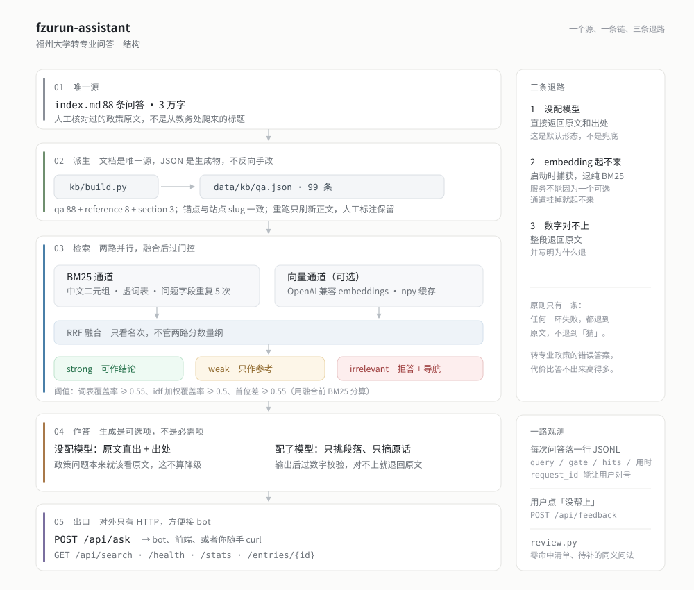
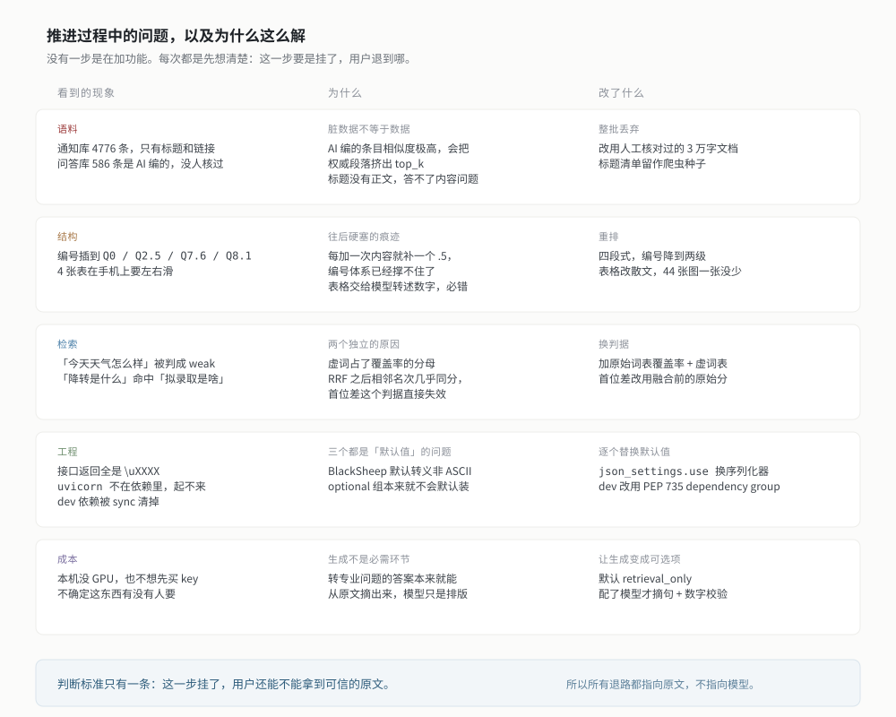

# fzurun-assistant

福州大学转专业问答服务。BlackSheep 后端，单页前端，对外只有 HTTP 接口。



## 快速开始

需要 Python 3.12 和 [uv](https://github.com/astral-sh/uv)。

```bash
uv sync
cp .env.example .env
uv run uvicorn fzurun.api.app:app --port 8000
```

打开 <http://127.0.0.1:8000>。不配任何 key 也能用：只有 BM25 检索，直接返回知识库原文和出处。

## 接口

| 方法 | 路径 | 说明 |
| --- | --- | --- |
| GET | `/api/health` | 条目数、启用的通道、模型是否就绪 |
| GET | `/api/stats` | 按类型和档位统计条目数 |
| GET | `/api/search?q=&k=` | 只检索，返回命中列表和门控结果 |
| POST | `/api/ask` | `{"query": "..."}`，返回答案和引用 |
| POST | `/api/feedback` | `{"request_id": "...", "verdict": "bad", "reason": "wrong"}` |
| GET | `/api/entries/{id}` | 单条原文 |

`/api/ask` 的返回字段：

| 字段 | 说明 |
| --- | --- |
| `answer` | 回答正文。模型模式下已过数字校验 |
| `mode` | `llm` 或 `retrieval_only` |
| `gate` | `strong` 可作结论，`weak` 只作参考，`irrelevant` 拒答 |
| `citations` | 引用的条目，含 `id`、`label`、`anchor`、`tier` |
| `navigation` | 拒答时给的三条相近问题 |
| `caveats` | 条目自带的前提说明，比如「非官方经验值」 |
| `request_id` | 反馈时带回来，能对上这次问答 |
| `latency_ms` | 端到端耗时 |

## 配置

全部走环境变量，前缀 `FZURUN_`，也可以写 `.env`。

| 变量 | 默认 | 说明 |
| --- | --- | --- |
| `FZURUN_LLM_BASE_URL` | 空 | OpenAI 兼容端点，留空则不生成 |
| `FZURUN_LLM_API_KEY` | 空 | |
| `FZURUN_LLM_MODEL` | 空 | 智谱填 `glm-4.5-flash` |
| `FZURUN_LLM_EXTRA_BODY` | 空 | 私有参数，智谱要填 `{"thinking":{"type":"disabled"}}` |
| `FZURUN_EMBED_BASE_URL` 等 | 空 | 配了才启用向量通道 |
| `FZURUN_TOP_K` | 5 | 返回多少条候选 |
| `FZURUN_RRF_K` | 60 | 融合参数，一般不用动 |
| `FZURUN_GATE_*` | 见 docs | 四个门控阈值，按 99 条语料标定，语料大改后要重标 |
| `FZURUN_LOG_ENABLED` | true | 写 JSONL 日志到 `data/logs/` |
| `FZURUN_LOG_QUERY` | true | 关掉只记门控和命中，不留问题原文 |

智谱的 Flash 系列默认开思考，会和答案抢 token，`EXTRA_BODY` 那行必须填。用 vllm、Ollama、Groq 时删掉。

## 知识库

`data/kb/qa.json` 从 Firefly 那份转专业文档派生，99 条。

```bash
uv run python scripts/build_kb.py            # 覆盖 data/kb/qa.json
uv run python scripts/build_kb.py --dry-run  # 只看报告
```

人工字段（`tier`、`caveats`、`related`）会保留，删掉的条目标成 `removed`，id 不回收。同义问法在 `data/kb/alt.json`，手写，目前 14 组。

## 设计取舍



为什么是单路 BM25、为什么不做真流式、为什么门控不用模型自评，见 [docs/DESIGN.md](docs/DESIGN.md)。试运行数据怎么收、怎么看，也在那里。

## 测试

```bash
uv run pytest -q
uv run ruff check src scripts tests
npx --yes markdownlint-cli2 README.md docs/*.md
```

## 已知问题

- 向量通道没实测，本机没配 embedding 服务。
- 没有输入护栏、限流、鉴权。公开部署前得加。
- 「转专业什么时候报名」还是弱命中，知识库缺这一条。

## 致谢

知识库来自 [福州大学转专业文档](https://docs.qq.com/doc/DQ2p3cmdkem9GbEV5) 上那份集体维护的转专业文档。RRF 的融合思路来自 [fzu-assistant](https://github.com/ShaddockNH3/fzu-assistant)。

## License

代码以 [MIT](LICENSE) 授权。`data/kb/` 下的知识库正文派生自上面那份集体维护的文档，版权归原维护者，不在 MIT 覆盖范围内。
